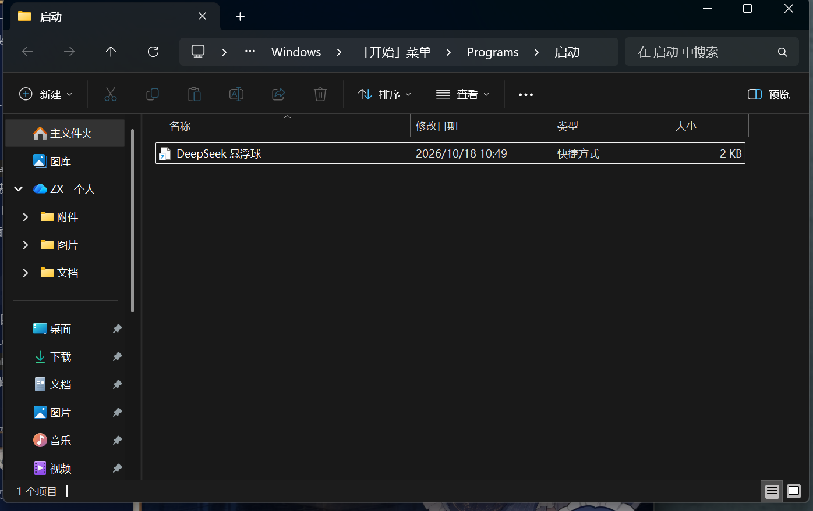
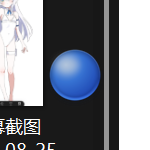

# DeepSeek 悬浮球 (DeepSeek Orb)

一颗常驻桌面的蓝色小球。点一下，DeepSeek 网页端就作为一个悬浮小窗弹出来——**给"边玩游戏 / 边看视频边随手问 AI"用**。

纯 Windows 原生：PowerShell + WinForms + 分层窗口，**不注入、不挂钩任何进程**，不碰游戏反作弊。



---

## 它做什么

- **点球开面板**：加载的是真正的 `chat.deepseek.com`，用 Edge 应用窗（独立 profile，登录一次长期有效）
- **永远置顶**：窗口化 / 无边框窗口化的游戏里也能浮在画面上
- **不挡操作**：球只有 34 px，可拖到任意角落，位置自动记忆
- **全屏自动隐藏**：检测到独占全屏 / D3D 全屏时自动收球，退出全屏自动回来
- **全局热键**：`Ctrl+Alt+D` 开合面板，FPS 游戏不用去够鼠标
- **游戏模式**：球缩到 80%、更淡



## 它不做什么（重要）

- **不是真内嵌**：面板是 Edge 自己的窗口，不是塞进我画的框里。`chat.deepseek.com` 有 `CSP frame-ancestors`，iframe 一律被拒，所以必须用真浏览器引擎承载。
- **独占全屏下看不见**：Windows 规则，不注入就绕不过。请把游戏设成**窗口化**或**无边框窗口化**。
- **打字必然抢焦点**：中文输入法要求焦点窗口，所以设计成"呼出 → 打 → 收起"，游戏会短暂失焦。
- **不能改网页内部 UI**：界面就是官网原样（改外观得走 CDP 注入，脆弱，没做）。

## 安装

要求：**Windows 10 / 11** + **Microsoft Edge**（系统自带）。不需要管理员权限。

1. 下载本仓库（`Code → Download ZIP` 后解压，或 `git clone`）
2. 双击 **`安装.cmd`** —— 在桌面创建「DeepSeek 悬浮球」快捷方式
3. 双击桌面快捷方式 → 点右下角蓝球 → 在弹出的窗口里**登录 DeepSeek**（只需一次）
4. 想开机自启：双击 **`开机自启-开启.cmd`**

> 为什么不给你一个 `.vbs` 双击就跑？因为不少机器上 `.vbs` 关联被软件搞坏了，双击会弹"选择一个应用"。本项目一律走"快捷方式 → powershell.exe"，不经过 `wscript`。

## 使用

| 操作 | 效果 |
|---|---|
| 左键单击球 | 打开 / 收起面板 |
| 左键拖动球 | 挪位置，松手记住 |
| 右键球 | 菜单：尺寸 / 无边框 / 游戏模式 / 自启 / 关闭面板进程 / 退出 |
| `Ctrl+Alt+D` | 全局热键开合面板 |

面板位置自动贴在球旁边，不会盖住球。

## 配置 `config.json`

首次运行自动生成，改完重启程序生效：

```jsonc
{
  "url": "https://chat.deepseek.com/",
  "widthDip": 300,          // 面板宽（DIP；150% 缩放下 1 DIP = 1.5 px）
  "heightDip": 350,
  "orbDip": 34,             // 球直径（DIP）
  "hotkey": "Ctrl+Alt+D",   // Ctrl/Alt/Shift/Win + A-Z / 0-9 / F1-F12
  "frameless": false,       // true = 去掉 Edge 标题栏，变成圆角浮卡
  "hideOnFullscreen": true,
  "gameMode": false,
  "orbX": -1,               // -1 = 默认位置（右下角）
  "orbY": -1
}
```

## 开机自启是怎么实现的

往 **启动文件夹**（`shell:startup`）放一个指向 `powershell.exe` 的快捷方式，不写注册表、不用 `.vbs`。

```powershell
# 查看状态 / 手动开关
powershell -ExecutionPolicy Bypass -File tools\autostart.ps1 status
```

程序启动时还会自动清理旧版本留下的 `wscript.exe …vbs` 注册表项。

## 排错

先看同目录的 **`orb.log`**（每次启动、开关面板都记一行）。

| 现象 | 处理 |
|---|---|
| 双击没反应 | 用 `启动悬浮球.bat`；仍无反应看 `orb.log` 有没有 `启动完成` |
| 日志里 `等待 Edge 窗口超时` | 确认 Edge 装在 `C:\Program Files (x86)\Microsoft\Edge\Application\msedge.exe`（程序会自动找三处 + 注册表） |
| 日志里 `访问被拒绝` / `启动 Edge 失败` | 安全软件拦了"隐藏窗口的 powershell"，把程序目录加白名单 |
| 想重新登录 | 删掉 `%LOCALAPPDATA%\DeepSeekOrb\edge-profile` |
| 热键冲突 | 日志写"注册失败"，改 `config.json` 的 `hotkey` |
| 球消失 | 可能被"全屏时自动隐藏"藏了（退出全屏），或已退出程序 |

## 安全

- 只用标准 Win32：`SetWindowPos` 置顶、`RegisterHotKey` 注册热键、`UpdateLayeredWindow` 画球
- **零进程注入、零 API hook**，不读写任何游戏内存，所以不会被反作弊判成 overlay 外挂
- 不联网上传任何数据；唯一的外部请求就是你打开的 DeepSeek 网页本身
- 全部源码可见（`orb.ps1` 一个文件 + 两个小工具脚本）

## 免责声明

非官方项目，与 DeepSeek 无关。界面版权归 DeepSeek 所有。请遵守 DeepSeek 服务条款。

## English

A tiny always-on-top blue orb for Windows. Click it → DeepSeek's web chat opens in a floating Edge app window (own profile, persistent login).

Windows-native: PowerShell + WinForms + layered window. **No process injection, no API hooks** — safe alongside anti-cheat. Works over windowed / borderless-windowed games; exclusive fullscreen cannot be covered without injection, so use borderless mode.

Install: double-click `安装.cmd` to create a desktop shortcut (no admin needed), then click the orb and log in once.

## License

[MIT](LICENSE)
